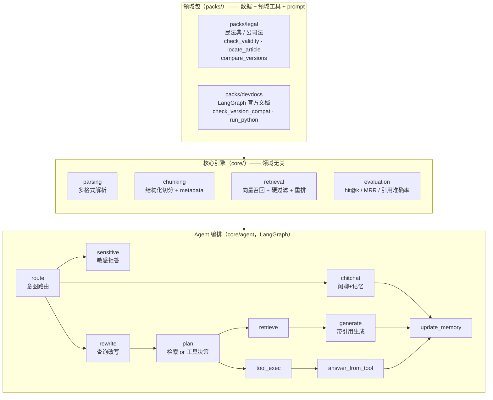

# rag-agent-engine

"引擎 + 领域包"架构的开源 Agentic RAG 项目：核心引擎（`core/`）沉淀可复用的解析、结构化切分、metadata 硬过滤检索、引用校验、评估与 LangGraph 编排能力；领域包（`packs/`）以插件形式接入公开数据，零 core 改动即可接入新领域。

当前内置两个领域实例：

- `packs/legal` —— 中国法律法规知识库 Agent：效力级别/时效状态硬过滤、条号定位、时效校验、新旧法对比（民法典 1260 条 + 公司法 2023/2018 双版本）
- `packs/devdocs` —— 开发者技术文档助手：库名+版本号过滤、版本兼容查询、Python 代码沙箱（LangGraph 官方文档 8 篇）

**状态**：W1–W6 完成，双领域评估基线全绿，130 个测试通过。

## 架构



设计约束：**core 不允许 import packs，packs 通过 `core/pack.py` 协议注册**——devdocs 包的接入没有改动 core 任何一行代码，这是架构复用性的实证。

## 快速开始

前置：本地 Ollama（`bge-m3` + `qwen2.5:7b`）+ Qdrant（docker），详见 `scripts/check_env.py` 的检测项。

```bash
uv sync
uv run python scripts/check_env.py            # 环境自检
uv run python scripts/chat.py --pack legal    # 法律问答机器人
uv run python scripts/chat.py --pack devdocs  # 技术文档助手
```

法律包对话示例（真机输出）：

```
> 诉讼时效是多久？
向人民法院请求保护民事权利的诉讼时效期间为三年……自权利人知道或者应当知道
权利受到损害以及义务人之日起计算 [1]。
引用来源：
  [1] 《中华人民共和国民法典》第一百八十八条（第一编 总则 · 第九章 诉讼时效）

> 公司法现在还有效吗？
[工具 check_validity] 《中华人民共和国公司法（2018）》已于 2024-07-01 起被
《中华人民共和国公司法（2023 修订）》替代，原法同时废止。
```

devdocs 包对话示例：

```
> StateGraph 怎么添加节点和边？
使用 `builder.add_node("节点名", 函数)` 注册节点，`builder.add_edge(START, "节点名")`
连接边…… [1]
引用来源：
  [1] langgraph-graph-api.md（LangGraph 官方文档）
```

## 评估基线

评估集为各包手工构造的小规模基线（legal 8 条 / devdocs 6 条，含拒答用例），
命令 `uv run python scripts/eval_pack.py --pack legal|devdocs`，完整逐条结果见
`eval_report.json` / `eval_report_devdocs.json`。

| 指标 | legal | devdocs |
|---|---|---|
| hit@k（召回命中） | 1.000 | 1.000 |
| MRR（首位排序） | 1.000 | 0.875 |
| 引用准确率（严格校验） | 1.000 | 1.000 |
| 越界拒答准确率 | 1.000 | 1.000 |

注：评估集规模小、与入库语料同源，指标偏乐观，仅作为回归基线使用，不代表开放域水平。

## 设计要点

- **metadata 硬过滤 DSL**：chunk 携带效力级别 / 时效状态 / 发文机关 / 条号等结构化字段，检索时用声明式 DSL 过滤——"引用条文必须现行有效"在召回层强制，不靠 prompt 自觉。
- **引用严格校验**：生成答案中的每条引用逐一对照检索结果，编号错位、来源不存在的引用判为失败，计入评估指标。
- **结构化切分**：法规按"编-章-节-条"层级切分并校验条号单调递增；chunk_id 由内容哈希确定性生成，重复入库幂等。
- **相关性阈值校准**：rerank 分数与向量分数口径不同，阈值分开校准——这是实测踩坑后沉淀的教训。
- **工具决策回退**：plan 节点由 LLM 自主决定检索还是调工具，决策失败/低置信时回退检索路径，保证兜底可用。
- **双人格温度**：闲聊高温度、问答低温度，同一模型两副面孔。

## 部署与压测

`deploy/docker-compose.yml` 提供 GPU 部署参考：Qdrant + 两个 vLLM 服务
（Qwen2.5-7B-Instruct 对话 + bge-m3 嵌入），配好 `RAE_` 环境变量即可对接。
**注意：该配置未在真实 GPU 环境验证过，仅作部署模板。**

压测脚本 `deploy/benchmark/bench.py`（OpenAI 兼容端点，并发 + 延迟分位数 + 吞吐）：

```bash
uv run python deploy/benchmark/bench.py --requests 12 --concurrency 3
```

本地实测参考（Apple Silicon Mac，Ollama / qwen2.5:7b，12 请求 3 并发，max_tokens=256）：

| 指标 | 数值 |
|---|---|
| 输出吞吐 | 21.1 tok/s |
| 延迟 p50 / p95 | 33.7 s / 35.9 s |
| 请求速率 | 0.09 req/s |

单机 Ollama 的吞吐远不及 vLLM 连续批处理，这正是部署层换 vLLM 的动机。

## 仓库结构

```
core/            引擎：parsing / chunking / indexing / retrieval / generation
                 agent(LangGraph) / evaluation / service / pack 协议
packs/legal/     法律包：编章节条切分、时效/条号/新旧法对比工具、评估集
packs/devdocs/   技术文档包：版本兼容查询、代码沙箱、评估集
scripts/         chat.py 对话入口、eval_pack.py 评估、fetch_*.py 数据采集
data/            公开语料（民法典/公司法双版本、LangGraph 官方文档）
deploy/          docker-compose（Qdrant+vLLM 模板）、benchmark/bench.py
docs/            architecture.md / implementation-plan.md
eval_report*.json  双领域评估基线报告
```

## Roadmap

已完成：端到端 RAG 链路、意图路由与多轮记忆、双领域包、工具自主决策、评估基线、压测脚本。

未做（后续方向）：FastAPI 服务层、MCP Server 暴露工具、更大规模评估集、真实 GPU 上的 vLLM 验证。

## 开发

```bash
uv sync
uv run ruff check .
uv run pytest          # 130 个测试，离线可跑（Fake 组件注入）
```
